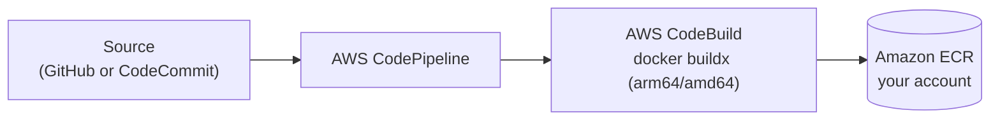
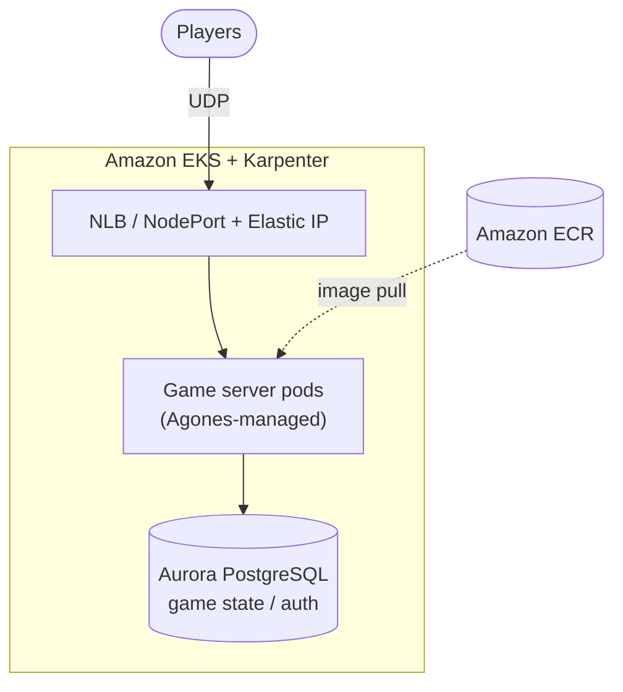

# Containerized Game Servers on Amazon EKS


A collection of reference examples for building, deploying, and operating
containerized, session-based game servers on Amazon EKS. Each sample is
self-contained and focuses on a specific pattern — dedicated UDP servers,
autoscaling with Karpenter, EC2 Spot handling, DDoS mitigation, public IPv4
exposure, and multi-architecture (arm64/amd64) image pipelines.

> [!NOTE]
> These examples build their CI/CD pipelines with AWS CodeCommit and/or GitHub as the pipeline source. AWS CodeCommit was closed to new customers in July 2024 but [returned to general availability in November 2025](https://docs.aws.amazon.com/codecommit/latest/userguide/history.html) and is open to new customers again, so the CodeCommit-based examples remain usable. The samples are kept current (pinned container base images, current Kubernetes/Karpenter APIs); see each sample's README for build and deploy steps.

## Architecture

Each sample follows the same two-part shape: a CI/CD pipeline that builds images
into **your own** Amazon ECR, and a runtime deployment on Amazon EKS.

**Image pipeline (per sample)**



**Runtime on Amazon EKS**



## Quick start

```bash
# 1. Clone
git clone https://github.com/aws-samples/containerized-game-servers.git
cd containerized-game-servers

# 2. Make sure the prerequisites below are in place (EKS cluster with Karpenter,
#    AWS CLI, CDK v2, Docker buildx, kubectl, envsubst).

# 3. For GitHub-sourced pipelines, create the token secret once:
aws secretsmanager create-secret --name githubtoken \
  --secret-string '{"token":"<GitHub token with repo + admin:repo_hook>"}'

# 4. Pick a sample and build its images into your ECR (example: supertuxkart).
#    Set the environment variables documented in the sample's README, then:
cd supertuxkart
./deploy-base-pipeline.sh    # builds the base image
./deploy-stk-pipeline.sh     # builds the game server image

# 5. Deploy to your cluster (manifests are rendered with envsubst):
cat <manifest>.yaml | envsubst | kubectl apply -f -
```

Exact environment variables and manifest names are documented in each sample's
own README.

## Samples

| Sample | Demonstrates | Badges |
|--------|--------------|--------|
| [supertuxkart](./supertuxkart) | Dedicated UDP game server using the Agones SDK for session lifecycle and player tracking |    |
| [lyra](./lyra) | Unreal Engine 5 Lyra Starter Game server with a NodePort-per-pod service and Elastic IP |    |
| [craft](./craft) | Voxel game that persists state in Aurora PostgreSQL, fronted by a Django auth service |    |
| [udp-nlb-sample](./udp-nlb-sample) | UDP game servers behind a Network Load Balancer with a TCP health-check sidecar |   |
| [mitigate-udp-flood-with-agones-iptables](./mitigate-udp-flood-with-agones-iptables) | Rate-limiting UDP ingress to mitigate flood attacks against game servers |   |
| [spot-sig-handler](./spot-sig-handler) | Graceful node draining on EC2 Spot interruption and rebalance notices |    |

## Common prerequisites

Most samples assume:

- An AWS account and the AWS CLI configured for it.
- An Amazon EKS cluster with [Karpenter](https://karpenter.sh/) for node
  provisioning. The provided cluster spec targets Kubernetes 1.33 on AL2023.
- [AWS CDK v2](https://docs.aws.amazon.com/cdk/v2/guide/home.html) for the image
  build pipelines (each sample's `deploy-*.sh` script runs `cdk deploy`).
- Docker with `buildx` for multi-architecture (arm64/amd64) image builds.
- `kubectl` and `envsubst` to render and apply the Kubernetes manifests.
- For GitHub-sourced pipelines, a Secrets Manager secret named `githubtoken`
  (JSON field `token`, using a token with `repo` and `admin:repo_hook` scopes).

Each sample's own README covers its specific build and deploy steps.

## How the samples are structured

- **Image pipelines** — CDK stacks (`*-pipeline-stack.ts`) define CodePipeline +
  CodeBuild jobs that build container images and push them to Amazon ECR in your
  own account. Repositories, tags, and base images are parameterized, so nothing
  depends on a sample-owner registry.
- **Kubernetes manifests** — applied with `envsubst | kubectl apply -f -`, so
  image URIs and cluster-specific values resolve from your environment.
- **Autoscaling** — Karpenter `NodePool` / `EC2NodeClass` (v1 APIs) provision
  right-sized nodes, including EC2 Spot capacity.

## Contributing and license

See [CONTRIBUTING.md](./CONTRIBUTING.md) and [CODE_OF_CONDUCT.md](./CODE_OF_CONDUCT.md).
This project is licensed under the terms in [LICENSE](./LICENSE) (Apache 2.0);
attributions are listed in [NOTICE](./NOTICE).
