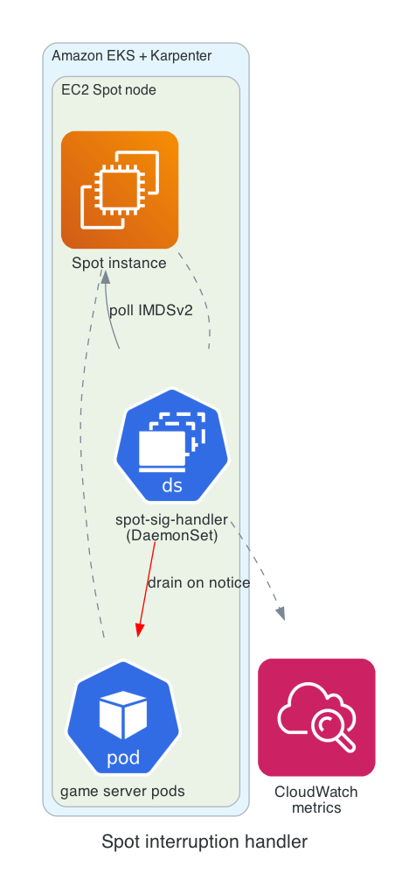

# Spot signal handler

A lightweight node-termination handler for EC2 Spot capacity on EKS. It runs as
a DaemonSet on Spot nodes, uses IMDSv2 to watch for EC2 rebalance
recommendations / Spot interruption notices, and gracefully drains the node so
game-server pods can be rescheduled before the instance is reclaimed.

## Architecture



## How it works

`start.sh` (the container entrypoint):

1. Fetches an IMDSv2 token and reads the node hostname from instance metadata.
2. Publishes the node instance type as a CloudWatch metric (namespace `spot-sig`).
3. Polls the metadata notice endpoint (`NOTICE_URL`, default is the rebalance
   recommendation endpoint) every `POLL_INTERVAL` seconds.
4. When a notice is received, publishes a `rebalance` CloudWatch metric and runs
   `kubectl drain <node> --force --ignore-daemonsets --delete-emptydir-data`.

## Components

| File | Purpose |
|------|---------|
| `Dockerfile` | Builds the arm64 image (Alpine + `kubectl` + AWS CLI). |
| `start.sh` | Entrypoint: metadata polling, metrics, and node drain. |
| `spot-sig-pipeline-stack.ts` / `spot-sig-pipeline.ts` | CDK pipeline that creates the `spotsig` ECR repo in your account and builds/pushes the image via CodeBuild. |
| `deploy-spot-sig-pipeline.sh` | Deploys the CDK pipeline. |
| `build.sh` | Builds and pushes the image. Reads `AWS_ACCOUNT_ID`, `AWS_REGION`, `SPOTSIG_REPO`, `SPOTSIG_TAG` (used by the CodeBuild project; falls back to sensible defaults for manual runs). |
| `spot-sig-handler-ds.yaml` | ServiceAccount, ClusterRole/Binding, and DaemonSet. The image URI is templated with `envsubst`. |

## Deploy

The image is built into **your own** ECR account. The DaemonSet image URI is
templated, so export the same variables before applying it.

```bash
export AWS_ACCOUNT_ID=$(aws sts get-caller-identity --query Account --output text)
export AWS_REGION=us-west-2
export SPOTSIG_REPO=spotsig
export SPOTSIG_TAG=aarch64
```

### Option A: build with CDK (recommended)

Creates the ECR repo and builds/pushes the image via CodeBuild in your account.
Requires an AWS CodeConnections connection to GitHub, authorized once in the
console (Developer Tools > Settings > Connections). No personal access token
needed.

```bash
export GITHUB_USER=<your-github-org-or-user>
export GITHUB_REPO=<your-fork-name>
export GITHUB_BRANCH=<branch>
export CONNECTION_ARN=<your-codeconnections-arn>
./deploy-spot-sig-pipeline.sh
```

### Option B: build manually

```bash
# Create the ECR repo (once)
aws ecr create-repository --repository-name "$SPOTSIG_REPO" --region "$AWS_REGION"
# Build and push into your account
./build.sh
```

### Deploy the DaemonSet

```bash
cat spot-sig-handler-ds.yaml | envsubst | kubectl apply -f -
```

## Configuration

Set via the DaemonSet container env:

| Variable | Default | Description |
|----------|---------|-------------|
| `AWS_DEFAULT_REGION` | `us-west-2` | Region for CloudWatch metrics. |
| `NOTICE_URL` | rebalance recommendation endpoint | Metadata endpoint to poll. Use `.../spot/termination-time` to react only to interruption notices. |
| `POLL_INTERVAL` | `5` | Seconds between metadata polls. |

The DaemonSet targets Spot nodes with `nodeSelector: karpenter.sh/capacity-type: spot`.

## Notes / hardening

- The bundled `ClusterRole` grants `"*"` on core and RBAC resources. Scope this
  down to the minimum needed (`nodes`, `pods`, `pods/eviction`, and the ability
  to cordon/drain) before using outside of a demo.
- For production, consider the maintained
  [AWS Node Termination Handler](https://github.com/aws/aws-node-termination-handler)
  or [Karpenter's native interruption handling](https://karpenter.sh/docs/concepts/disruption/#interruption),
  which cover Spot interruptions, rebalance recommendations, and scheduled events.
